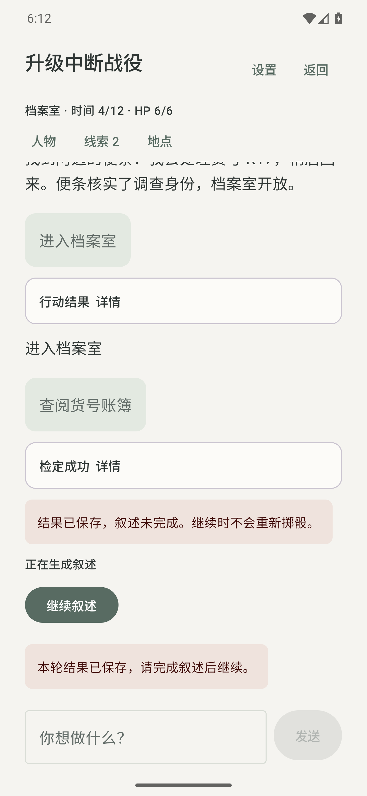
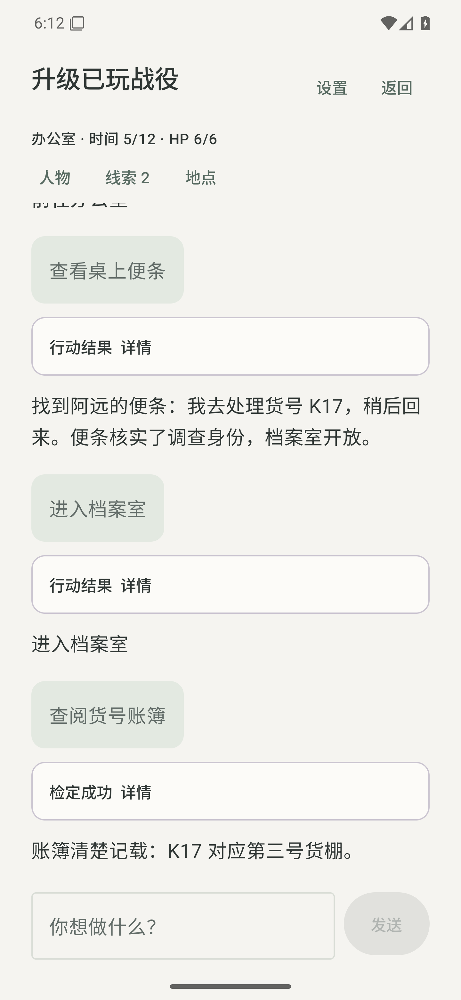
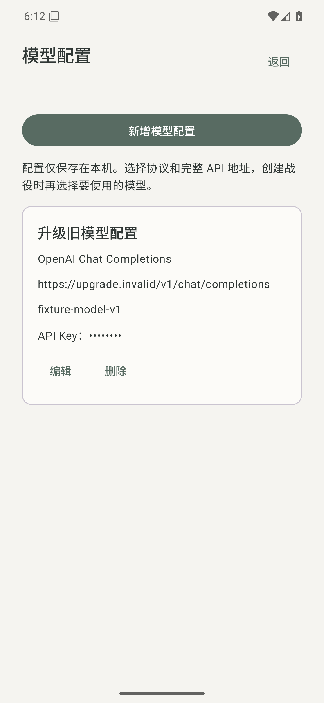

# 二十面骰 0.2.0 交付验收

2026-11-02。本版将已发布的“雨夜跑团”精简为专用 Android 跑团应用，并已公开发布。

[下载安装包](https://github.com/CGM2026/OperitRPG/releases/download/rpg-v0.2.0/operit-rpg-0.2.0.apk) · [版本发布页](https://github.com/CGM2026/OperitRPG/releases/tag/rpg-v0.2.0) · [公开源码](https://github.com/CGM2026/OperitRPG)

已有 0.1.0 时，在手机内检查新版并覆盖安装即可。不要先卸载旧应用。安装完成后图标名称变为“二十面骰”，原战役继续使用。

## 实际结果

- APK：1,764,967 字节，约 1.76 MB；原版 404,672,345 字节，体积减少 99.56%。
- 移除通用 Agent、设备自动化、终端、浏览器、本地推理、语音、虚拟形象及插件模块；正常构建只含 app 和 rpg-core。
- 保留战役、角色、地点、线索、物品、检定、历史记录、导入导出及手机内更新。
- 黑体、低饱和配色、28dp 页面留白；新增专用模型配置页面。
- 仅保留界面所需 AndroidX 绘图原生组件，四种架构合计 37,392 字节；没有旧框架引擎和工具原生库。
- 内置模组和旧规则保持不变，改名没有把已有百分骰规则改为 D20 规则。

## 已通过的验证

[候选构建与测试](https://github.com/CGM2026/OperitRPG/actions/runs/41397802673)：74 项 JVM 测试全部通过，包含规则核心 29、旧固定备份样本 1、备份读写 9、模型接口 16、模型配置兼容 8、更新下载校验 5、更新策略 6。正式 APK 的代码/资源压缩、发布检查、签名和体积检查通过。

[Android 覆盖升级测试](https://github.com/CGM2026/OperitRPG/actions/runs/41398093824)：安装同包名、同签名的 schema 1 数据夹具，再用本次真实候选 APK 执行覆盖安装，全程不清除数据。验证了：

1. 原数据库记录、选中战役和模型配置文件在首次启动前保持不变。
2. 旧战役的四轮记录、两个线索、骰点 30 保留。
3. 手动继续中断叙述后不重掷、不再次结算；旧四轮事件保持不变。
4. 已玩战役能够继续第五步，时间推进到 5，地点进入办公室。
5. 旧模型配置在专用页面可见，API Key 遮罩显示，查看配置不会重写旧偏好文件。
6. 应用显示名为“二十面骰”，实际运行的是不可调试的压缩正式包。

发行页上传的是这一份已测候选 APK，发布时没有重新编译。

## 兼容边界与手机验收

升级夹具按 0.1.0 真实数据库和序列化格式生成，不是用户的私人存档，也不是在模拟器中运行历史 ARM64 旧 APK。固定旧备份样本来自与 0.1.0 相同的导出代码。真实手机上的旧 APK 覆盖安装、厂商安装器返回、旋转/进程终止、真实 API 连通性和长团主持质量仍需验收。

普通兼容 API 配置保留原 ID 和指纹。旧 OAuth、多密钥、自定义请求头和参数不再执行，原记录保留并提示重新配置。支持 OpenAI Chat、OpenAI Responses、Anthropic 和 Gemini 文本接口；离线演示始终需明确选择，没有自动降级。

建议在手机依次检查：从旧版检查更新 → 覆盖安装 → 打开原战役核对骰点/线索 → 继续一个行动 → 导出再导入备份 → 在设置检查最新版。完整操作见[手机验收指南](https://github.com/CGM2026/OperitRPG/blob/main/docs/TODO/rpg_prototype_v01/ACCEPTANCE.md)。

## 应用与证书

- 版本：0.2.0 / versionCode 2
- 应用 ID：`io.github.cgm2026.operitrpg`
- 数据库：`rpg-v1.db`，schema 1，没有数据清空或破坏性迁移
- 源码提交：`6ec6dea2dfb9f87d5401e76d50393718b3f45837`
- APK SHA-256：`d20d88add84cc57d298dcf8f5e159838b027326b78e7248a4c752d9ffe44864c`
- 签名证书 SHA-256：`8838939d69b547bbe6a27483da9819e07fe9e2799b66e5e3b51360df9cbbc373`
- 内置模组 SHA-256：`a3b971e9f26d449e08a99b575dfa660b32f33c12d21b445f5e714045e61facaa`

发布证书与 0.1.0 相同，没有重新生成；私钥不进入公开仓库。仓库名称保留 OperitRPG，使旧版更新地址继续有效。系统备份只包含战役与页面选择，不包含模型凭据。

## 模拟器实拍

