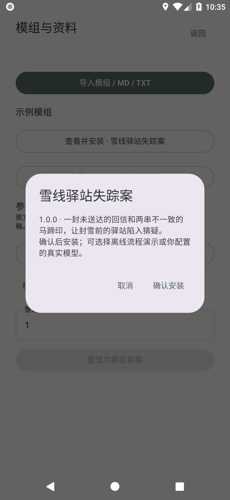
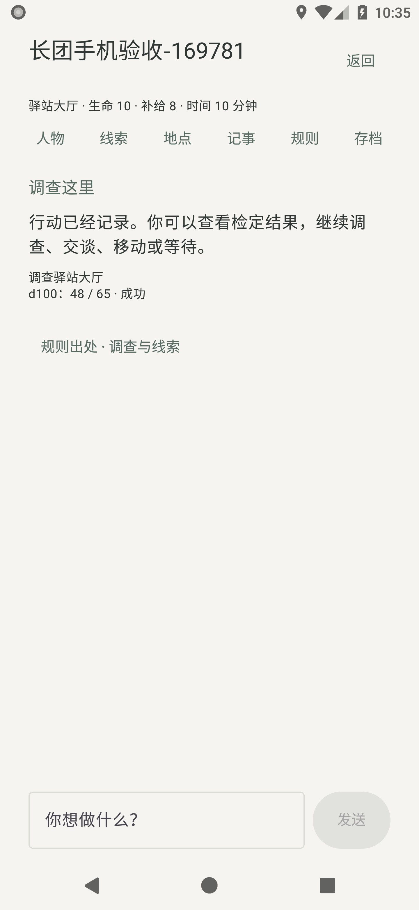
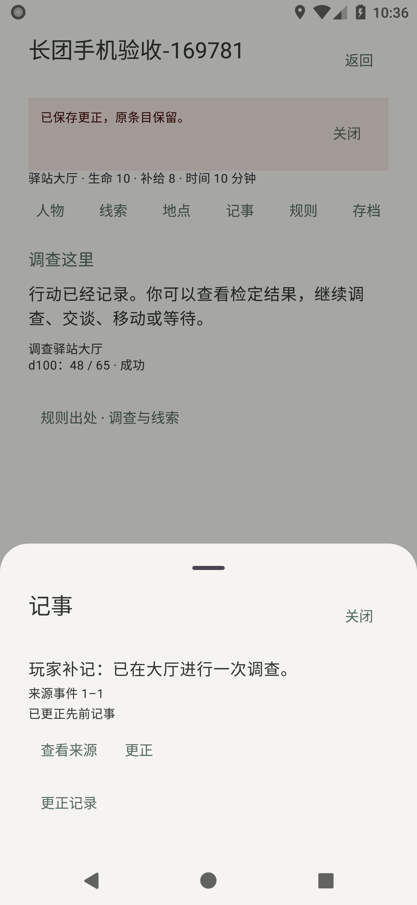
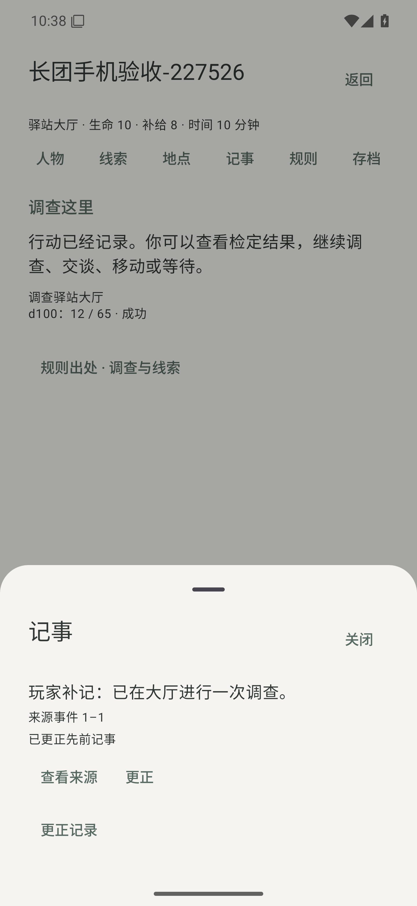

# 二十面骰 0.3.0 测试报告

本次交付为可覆盖安装的 Android 预发布测试版。自动测试和下列模拟器验收通过；真实云端模型、个人手机与长期叙述质量由用户验收，本次未使用付费 API。

## 安装包身份

|项目|结果|
|---|---|
|版本|0.3.0 / Android versionCode 3|
|应用名 / 包名|二十面骰 / io.github.cgm2026.operitrpg|
|安装包|1,976,439 字节（1.98 MB）|
|最低系统|Android 8.0 / API 26|
|源代码提交|9b59d2430e01a740bbf5067fed60960cb45fc28c|
|APK SHA-256|c8f08d74868a1003560bafeb1c993bba1b33032ca3c2d1b10d0a30d489c0ea47|
|签名证书 SHA-256|8838939d69b547bbe6a27483da9819e07fe9e2799b66e5e3b51360df9cbbc373|

使用与 0.1 / 0.2 相同的永久签名。请直接覆盖安装，不要先卸载。可在手机打开发布页下载 APK；测试版不替换 GitHub 最新稳定版，0.2 的“检查新版”不会提示此预发布包。后续正式版的手机内检查、下载与安装继续可用。

## 本版实际可验收能力

- 统一旧战役与新长团入口；旧 rpg-v1.db、schema1、DTO、模组哈希和格式1备份保持兼容。
- 校验并导入数据型 rpgmodule ZIP；不可变模组版本。两个原创外部模组分别有6地点、12名NPC、3章推进目标。
- MD/TXT原文导入、阅读、绑定战役并检索；明确选择模型后可整理不超过6000字为JSON草稿，编辑、校验、确认激活。真实模型整理效果本次未测。
- 严格JSON工具循环：查规则、查记事、检查局部世界、读NPC状态与知情事实。程序校验计划、掷骰并事务提交；重试旁白不重掷。
- 长期保存事件与对话记事，检索前按战役和权限过滤。对话是原话记录，不自动当成世界事实。更正保留原条目和来源，可查看精确回合。
- NPC身份、位置、状态、关系、目标与知情边持久化；在场行动可修改状态、关系及知识。
- 格式2完整备份按页导出历史，携带依赖模组、规则及绑定资料；恢复重放验证并分配新战役ID，要求重新绑定本机模型。
- 显式离线流程演示可验证工具、结算与存档。真实模型失败不会转为离线演示或自动重试。

## 自动与设备测试

JVM测试 **108 项通过**，无失败、错误或跳过。以下循环样本不是额外的独立测试数，也不代表真实模型准确率。

|覆盖|检查内容|
|---|---|
|旧引擎|原规则回归；PLANNING、NEEDS_CONFIRMATION、PREPARED、RESOLVED、NARRATING固定序列化夹具；冻结哈希不变；已结算骰点与事件不重复|
|Agent运行时|多步查询、严格JSON、未知工具拒绝、计划校验、取消迟到响应、提交故障边界、旁白续写、两模组三章推进与事件重放|
|权限与上下文|1000组角色权限组合；GM规则不进入公开旁白；局部上下文不随1万离场NPC/事实全部注入；混合资料的公开规则不公开同文件秘密|
|长历史|1万事件重放；Room 1万回合分页、完整备份与恢复；不把全部历史塞进单一数据库字段|
|检索与记忆|100条规则金标（80中文，合成固定语料）；200条确定性记忆查询；对话记事重开、检索、更正和精确来源备份|
|文件与模型接口|非法ZIP路径/条目/摘要/大小、UTF-8分块；4种文字模型协议Mock服务器；原备份兼容；下载身份/大小/摘要/证书策略|

|系统|数据测试|旧存档覆盖升级|新长团界面|独立进程恢复|
|---|---:|---:|---:|---:|
|API 26 x86_64 模拟器|8项通过|1项通过|1项通过|1项通过|
|API 36 x86_64 模拟器|8项通过|1项通过|1项通过|1项通过|

升级过程：同签名夹具写入旧 schema1 战役、固定骰点、线索、失败旁白及假模型偏好 → 安装公开真实0.2 APK（固定SHA-256，保留夹具数据）→ 覆盖本次正式签名候选 → 对比旧数据并从界面继续。0.2安装后不先打开，以便在0.3打开前逐字节比较。不是用户个人存档，也未在x86上运行最初ARM64完整0.1 APK。

新界面从按钮进入示例预览、安装、新建战役、显式离线模型、发送行动；检查两次真实只读工具、一条真实事件、公开人物、规则出处、记事来源与更正；重新打开Activity及独立进程后事件保持一致。完整截图与原始日志保存在下方双系统验收任务的两个 evidence 附件中；代表界面见报告末尾。

[构建与完整JVM测试](https://github.com/CGM2026/OperitRPG/actions/runs/41428485628) · [双系统数据与覆盖升级验收](https://github.com/CGM2026/OperitRPG/actions/runs/41429127892)

## 尚未完成或本次未验证

- **未做真实模型长团验收**：自由行动、隐含剧透、叙述矛盾、跨章记忆召回质量和费用需用户验收。Mock与离线演示不代表真实模型能力。
- **离场NPC自主调度尚未实现**；目前NPC随明确行动更新，不会在后台自主推进世界。
- **自动摘要尚未接模型与UI**；已有任务与来源存储，实际长期记忆依赖事件/对话记事和检索。结构化承诺抽取及主张审核界面尚未实现。
- 只有原创通用百分骰适配器；没有完整CoC/D&D、多玩家同步、PDF/OCR、任意脚本/插件、语音或通用手机自动化。
- 1万回合测试证明规定样本可保存、分页及备份，不等于低端手机任意规模的耗时/内存保证。本次为CI模拟器，不是用户手机。

## 手机验收顺序

1. 覆盖安装后先打开旧战役，核对人物、骰点和中断回合；不要卸载旧应用。
2. 到“设置 → 模组与资料”安装示例，新建长团并明确选择“离线流程演示”。调查、移动、交谈后重启，查看人物、规则、记事来源与更正。
3. 导出长团备份并导入为新战役，重新绑定模型；核对资料、记事与历史。
4. 配置自己的服务并建立真实模型战役。先验收10至20轮自由行动，再检查跨章记忆、NPC知情边界和中断续写。反馈具体操作与错误提示，不要附API Key。

## 实际安装包界面

以下为 CI 模拟器截图，使用显式离线流程演示，不是生成的设计图。

模组预览

行动结算与规则出处

保留来源的记事更正

独立进程重启后的记事

